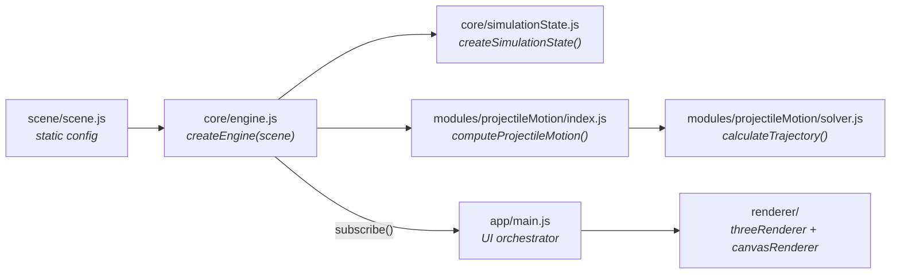
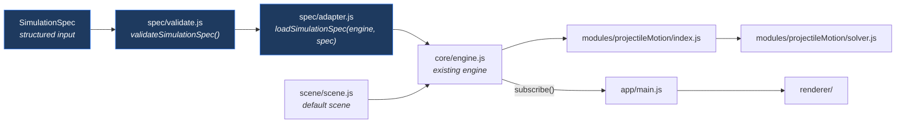
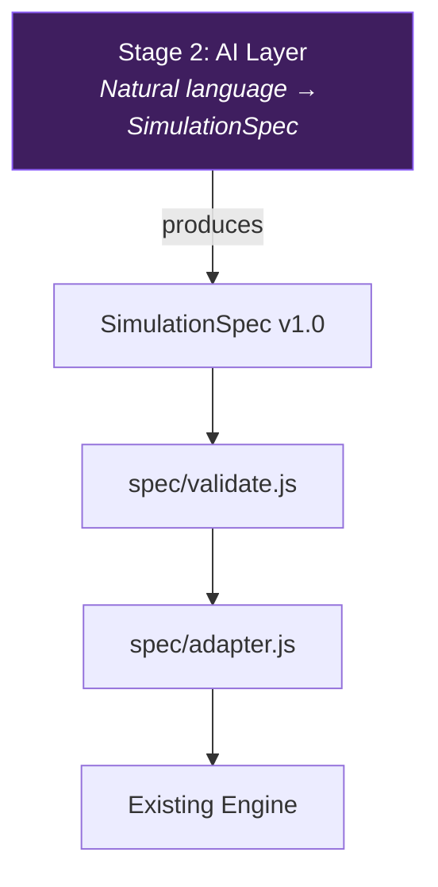

# Stage 1: Structured Simulation Pipeline — Implementation Plan

## Goal

Prove that Mechanica can accept a **structured, versioned projectile-motion specification** and transform it into a correct, interactive simulation — without any AI dependencies.

This establishes the pipeline that future AI-generated data will flow through.

---

## A. Existing Architecture Analysis

### Current Data Flow



### Key Function Signatures (Current)

| File | Function | Input | Output |
|---|---|---|---|
| [scene.js](file:///d:/Python/PROJECT%20MECHANICA/scene/scene.js) | `scene` (export) | — | `{ concepts, projectile: { velocity, angle, gravity, launchHeight } }` |
| [engine.js](file:///d:/Python/PROJECT%20MECHANICA/core/engine.js#L13-L19) | `createEngine(scene)` | scene object | Engine instance with `{ init, launch, reset, setParameters, subscribe, ... }` |
| [simulationState.js](file:///d:/Python/PROJECT%20MECHANICA/core/simulationState.js#L9-L28) | `createSimulationState(initialParams)` | `{ initialVelocity, launchAngleDegrees, gravity }` | Full state object |
| [index.js](file:///d:/Python/PROJECT%20MECHANICA/modules/projectileMotion/index.js#L11-L27) | `computeProjectileMotion(params, timeStep)` | `{ initialVelocity, launchAngleDegrees, gravity }` | `{ trajectory, flightMetrics, initialPoint, parameters }` |
| [solver.js](file:///d:/Python/PROJECT%20MECHANICA/modules/projectileMotion/solver.js#L43-L58) | `calculateTrajectory(params, timeStep)` | `{ initialVelocity, launchAngleDegrees, gravity }` | `{ trajectory[], flightMetrics }` |

### Internal Parameter Shape

Throughout the pipeline, the physics parameters are normalised to this canonical shape:

```js
{
  initialVelocity: number,      // m/s
  launchAngleDegrees: number,   // degrees
  gravity: number               // m/s²
}
```

The module index already normalises aliases (`velocity` → `initialVelocity`, `angle` → `launchAngleDegrees`) at [index.js:12–16](file:///d:/Python/PROJECT%20MECHANICA/modules/projectileMotion/index.js#L12-L16).

### Architectural Constraints Identified

1. **Engine owns state and animation loop.** The engine creates the simulation state, computes trajectories, and manages playback. All UI is driven by engine `subscribe()` callbacks.
2. **Solver is pure and stateless.** It takes parameters + timeStep, returns deterministic results. No side effects, no renderer dependency.
3. **Scene is a static default.** Currently hardcoded in `scene.js` with no validation or versioning.
4. **No input validation exists anywhere.** Parameters are passed directly through without range checks, type checks, or completeness checks.
5. **Engine's `setParameters()` only accepts partial updates.** It mutates existing state parameters one-by-one, stopping animation and recalculating. This is the current "change parameters at runtime" pathway.

---

## B. Proposed Stage 1 Changes

### Architecture After Stage 1



The core insight: **we do not need to modify the engine, solver, renderer, or simulation state.** The existing `engine.setParameters()` + `engine.launch()` pathway already does everything needed. Stage 1 adds a validated entry point above this.

---

### Component 1: Simulation Specification Schema

#### [NEW] `spec/simulationSpec.js`

Defines the versioned structured specification that any input source (hardcoded test, future AI, future UI form) must conform to.

```js
/**
 * SimulationSpec v1.0 — Structured Projectile Motion Specification
 *
 * This is the contract between any input source and the Mechanica
 * simulation pipeline. The solver, engine, and renderer are agnostic
 * to how this spec was produced.
 *
 * Future AI integration will produce objects conforming to this schema.
 */

/**
 * @typedef {Object} ProjectileMotionSpec
 * @property {number} initialVelocity     - Launch speed in m/s. Range: (0, 1000].
 * @property {number} launchAngleDegrees  - Launch angle in degrees. Range: [0, 90].
 * @property {number} gravity             - Gravitational acceleration in m/s². Range: (0, 100].
 * @property {number} [launchHeight]      - Initial height in m. Range: [0, 1000]. Default: 0.
 *                                          Reserved for future solver extension.
 */

/**
 * @typedef {Object} SimulationSpec
 * @property {string} version             - Schema version. Must be "1.0".
 * @property {string} module              - Physics module identifier. Must be "projectileMotion".
 * @property {ProjectileMotionSpec} parameters - Physical parameters for the simulation.
 * @property {Object} [metadata]          - Optional provenance metadata.
 * @property {string} [metadata.source]   - Origin identifier (e.g. "manual", "ai", "test").
 * @property {string} [metadata.description] - Human-readable description of the scenario.
 */

export const SIMULATION_SPEC_VERSION = "1.0";

export const SUPPORTED_MODULES = ["projectileMotion"];

export const PARAMETER_RANGES = {
  projectileMotion: {
    initialVelocity:    { min: 0.01, max: 1000, required: true },
    launchAngleDegrees: { min: 0,    max: 90,   required: true },
    gravity:            { min: 0.01, max: 100,   required: true },
    launchHeight:       { min: 0,    max: 1000,  required: false, default: 0 },
  }
};
```

**Design decisions:**
- `version` field enables non-breaking schema evolution.
- `module` field enables future physics modules (circular motion, pendulum, etc.) without changing the spec structure.
- `metadata.source` is explicitly not used in physics calculations — it exists solely for provenance tracking. The solver never sees it.
- `launchHeight` is declared but marked optional/reserved. The current solver doesn't support it; it won't break validation but won't affect output yet.
- Ranges are physically motivated: velocity and gravity must be positive; angle is [0°, 90°] for standard projectile motion.

---

### Component 2: Input Validation

#### [NEW] `spec/validate.js`

```js
import {
  SIMULATION_SPEC_VERSION,
  SUPPORTED_MODULES,
  PARAMETER_RANGES,
} from "./simulationSpec.js";

/**
 * @typedef {Object} ValidationResult
 * @property {boolean} valid
 * @property {Object|null} spec        - The validated/normalised spec (null if invalid).
 * @property {string[]} errors         - List of human-readable validation errors.
 * @property {string[]} warnings       - Non-fatal notices (e.g. defaults applied).
 */

/**
 * Validates a SimulationSpec object.
 *
 * Returns a normalised copy with defaults applied, or an error report.
 * Never throws — always returns a ValidationResult.
 *
 * @param {*} input - The raw input to validate.
 * @returns {ValidationResult}
 */
export function validateSimulationSpec(input) {
  const errors = [];
  const warnings = [];

  // 1. Structural checks
  if (input == null || typeof input !== "object") {
    return { valid: false, spec: null, errors: ["Input must be a non-null object."], warnings };
  }

  if (input.version !== SIMULATION_SPEC_VERSION) {
    errors.push(`Unsupported spec version "${input.version}". Expected "${SIMULATION_SPEC_VERSION}".`);
  }

  if (!SUPPORTED_MODULES.includes(input.module)) {
    errors.push(`Unsupported module "${input.module}". Supported: ${SUPPORTED_MODULES.join(", ")}.`);
  }

  if (input.parameters == null || typeof input.parameters !== "object") {
    errors.push("Missing or invalid 'parameters' object.");
    return { valid: false, spec: null, errors, warnings };
  }

  // 2. Parameter validation against schema ranges
  const moduleRanges = PARAMETER_RANGES[input.module];
  if (!moduleRanges) {
    errors.push(`No parameter schema found for module "${input.module}".`);
    return { valid: false, spec: null, errors, warnings };
  }

  const normalised = {};
  for (const [key, range] of Object.entries(moduleRanges)) {
    const value = input.parameters[key];

    if (value === undefined || value === null) {
      if (range.required) {
        errors.push(`Missing required parameter "${key}".`);
      } else {
        normalised[key] = range.default;
        warnings.push(`Parameter "${key}" not provided; using default ${range.default}.`);
      }
      continue;
    }

    const num = Number(value);
    if (!Number.isFinite(num)) {
      errors.push(`Parameter "${key}" must be a finite number. Got: ${value}.`);
      continue;
    }

    if (num < range.min || num > range.max) {
      errors.push(`Parameter "${key}" = ${num} is out of range [${range.min}, ${range.max}].`);
      continue;
    }

    normalised[key] = num;
  }

  if (errors.length > 0) {
    return { valid: false, spec: null, errors, warnings };
  }

  // 3. Build normalised spec
  const validSpec = {
    version: SIMULATION_SPEC_VERSION,
    module: input.module,
    parameters: normalised,
    metadata: input.metadata ?? { source: "unknown" },
  };

  return { valid: true, spec: validSpec, errors: [], warnings };
}
```

**Design decisions:**
- Never throws. All consumers get a structured result they can inspect.
- Returns a normalised *copy*, never mutates input.
- Warnings are distinct from errors — allows graceful degradation.
- The function is completely synchronous and has no dependencies on the engine, renderer, or DOM.

---

### Component 3: Pipeline Adapter

#### [NEW] `spec/adapter.js`

The bridge between validated specs and the existing engine. This is intentionally thin — it translates spec parameters into the engine's existing `setParameters()` API, then triggers `launch()`.

```js
import { validateSimulationSpec } from "./validate.js";

/**
 * Loads a SimulationSpec into a running engine instance.
 *
 * Validates the spec, applies parameters via the engine's existing API,
 * and triggers a launch. Returns the validation result for the caller
 * to inspect.
 *
 * @param {Object} engine  - A Mechanica engine instance (from createEngine).
 * @param {Object} rawSpec - A raw SimulationSpec object.
 * @param {Object} [options]
 * @param {boolean} [options.autoLaunch=true] - Whether to auto-launch after loading.
 * @returns {ValidationResult}
 */
export function loadSimulationSpec(engine, rawSpec, options = {}) {
  const { autoLaunch = true } = options;
  const result = validateSimulationSpec(rawSpec);

  if (!result.valid) {
    console.error("[Mechanica] Invalid SimulationSpec:", result.errors);
    return result;
  }

  if (result.warnings.length > 0) {
    console.warn("[Mechanica] SimulationSpec warnings:", result.warnings);
  }

  const { parameters } = result.spec;

  // Use the engine's existing parameter-setting pathway.
  // This preserves all existing state management, trajectory
  // recalculation, and subscriber notification.
  engine.setParameters({
    initialVelocity: parameters.initialVelocity,
    launchAngleDegrees: parameters.launchAngleDegrees,
    gravity: parameters.gravity,
  });

  if (autoLaunch) {
    engine.launch();
  }

  return result;
}
```

**Design decisions:**
- The adapter uses `engine.setParameters()` + `engine.launch()` — the exact same pathway that slider changes and the Launch button use. This means **zero changes to the engine are required**.
- `autoLaunch` flag allows callers to set parameters without immediately animating (useful for tests, or a future "preview before launch" flow).
- Returns the full validation result so callers can surface errors/warnings in UI.

---

### Component 4: Example Specifications

#### [NEW] `spec/examples.js`

Pre-defined test specifications that serve as both documentation and test fixtures.

```js
import { SIMULATION_SPEC_VERSION } from "./simulationSpec.js";

/**
 * Canonical 45° — maximum range case.
 * Known analytical solution: range = v²/g = 42²/9.81 ≈ 179.82 m
 */
export const SPEC_45_DEGREES = {
  version: SIMULATION_SPEC_VERSION,
  module: "projectileMotion",
  parameters: {
    initialVelocity: 42,
    launchAngleDegrees: 45,
    gravity: 9.81,
  },
  metadata: {
    source: "test",
    description: "45° launch — maximum range for flat ground",
  },
};

/**
 * Lunar gravity scenario.
 * Same velocity/angle, much lower gravity → longer flight, higher arc.
 */
export const SPEC_LUNAR = {
  version: SIMULATION_SPEC_VERSION,
  module: "projectileMotion",
  parameters: {
    initialVelocity: 42,
    launchAngleDegrees: 45,
    gravity: 1.62,
  },
  metadata: {
    source: "test",
    description: "45° launch under lunar gravity (1.62 m/s²)",
  },
};

/**
 * Steep launch — 80° angle, moderate velocity.
 * Tall, narrow trajectory. Tests renderer scaling with extreme aspect ratios.
 */
export const SPEC_STEEP = {
  version: SIMULATION_SPEC_VERSION,
  module: "projectileMotion",
  parameters: {
    initialVelocity: 25,
    launchAngleDegrees: 80,
    gravity: 9.81,
  },
  metadata: {
    source: "test",
    description: "80° steep launch — tall narrow arc",
  },
};

/**
 * Shallow, fast launch — 10° angle, high velocity.
 * Long, flat trajectory. Tests renderer at wide horizontal scale.
 */
export const SPEC_SHALLOW_FAST = {
  version: SIMULATION_SPEC_VERSION,
  module: "projectileMotion",
  parameters: {
    initialVelocity: 55,
    launchAngleDegrees: 10,
    gravity: 9.81,
  },
  metadata: {
    source: "test",
    description: "10° shallow fast launch — long flat arc",
  },
};

/**
 * Edge case: zero-degree angle (horizontal launch from ground).
 * Trajectory should be a single point (no flight).
 */
export const SPEC_HORIZONTAL = {
  version: SIMULATION_SPEC_VERSION,
  module: "projectileMotion",
  parameters: {
    initialVelocity: 30,
    launchAngleDegrees: 0,
    gravity: 9.81,
  },
  metadata: {
    source: "test",
    description: "Horizontal launch — zero flight time from ground level",
  },
};

/**
 * Edge case: 90° straight-up launch.
 * Zero range, maximum height = v²/(2g).
 */
export const SPEC_VERTICAL = {
  version: SIMULATION_SPEC_VERSION,
  module: "projectileMotion",
  parameters: {
    initialVelocity: 30,
    launchAngleDegrees: 90,
    gravity: 9.81,
  },
  metadata: {
    source: "test",
    description: "Vertical launch — zero range, pure vertical flight",
  },
};
```

---

### Component 5: Minimal Engine Enhancement

#### [MODIFY] `core/engine.js`

> [!IMPORTANT]
> Only **one** addition is proposed: exposing a `loadSpec()` convenience method on the engine instance. This is a thin wrapper around the adapter. The existing engine internals remain **completely unchanged**.

```diff
 import { computeProjectileMotion } from "../modules/projectileMotion/index.js";
 import { createSimulationState } from "./simulationState.js";
+import { loadSimulationSpec } from "../spec/adapter.js";

 // ... (all existing code unchanged) ...

   return {
     init,
     getState,
     launch,
     replay,
     reset,
     setParameters,
     setShowVelocityComponents,
     scrubToTrajectoryIndex,
     setDragging,
     stopAnimation,
     subscribe,
+    loadSpec: (rawSpec, options) => loadSimulationSpec(engineInstance, rawSpec, options),
     TIME_STEP
   };
```

To make the self-reference work, we add a minor refactor inside `createEngine`:

```diff
-  return {
+  const engineInstance = {
     init,
     getState,
     // ... all existing methods ...
+    loadSpec: null,  // set below
     TIME_STEP
   };
+  engineInstance.loadSpec = (rawSpec, options) => loadSimulationSpec(engineInstance, rawSpec, options);
+  return engineInstance;
```

**Justification:** This is the only change to an existing file. It adds a single convenience method that delegates entirely to the new adapter. The engine's internal logic, state management, and subscriber system are untouched.

---

### File Inventory Summary

| Action | File | Justification |
|--------|------|---------------|
| **NEW** | `spec/simulationSpec.js` | Schema definition and version constant |
| **NEW** | `spec/validate.js` | Input validation — pure function, no DOM dependency |
| **NEW** | `spec/adapter.js` | Bridges validated spec → existing engine API |
| **NEW** | `spec/examples.js` | Test fixtures and documentation-by-example |
| **NEW** | `spec/__tests__/validate.test.js` | Validation unit tests |
| **NEW** | `spec/__tests__/pipeline.test.js` | End-to-end pipeline integration tests |
| **MODIFY** | `core/engine.js` | Add `loadSpec()` convenience method (3 lines changed) |

**Files NOT modified (and why):**

| File | Reason |
|------|--------|
| `modules/projectileMotion/solver.js` | Already pure, stateless, correct. No changes needed. |
| `modules/projectileMotion/index.js` | Already normalises aliases. No changes needed. |
| `core/simulationState.js` | State factory is sufficient. No changes needed. |
| `renderer/*` | Renderers consume state objects. No changes needed. |
| `app/main.js` | UI orchestrator. No changes needed for Stage 1. |
| `app/sim.html` | No HTML changes needed. |
| `scene/scene.js` | Remains the default scene. Not modified. |

---

## C. Interfaces Designed for Future AI Integration

### Future Stage 2: AI Interpretation Layer

The `spec/` directory is intentionally designed as the **contract boundary** for AI integration:



**What Stage 2 needs to produce:** A `SimulationSpec` object. Nothing else.

**What Stage 2 does NOT need to know about:**
- How the solver works internally
- How the renderer draws trajectories
- How the engine manages animation state
- Any internal data shapes

**The validation layer guarantees** that malformed AI output is caught before it reaches the solver. The AI layer doesn't need to understand physics parameter ranges — the schema enforces them.

### Future Stage 3+: Additional Physics Modules

The `module` field in SimulationSpec and the `SUPPORTED_MODULES` / `PARAMETER_RANGES` registries are designed to be extended:

```js
// Future: adding circular motion
SUPPORTED_MODULES.push("circularMotion");
PARAMETER_RANGES.circularMotion = {
  radius: { min: 0.01, max: 1000, required: true },
  angularVelocity: { min: 0.01, max: 100, required: true },
  // ...
};
```

The adapter would gain a module-routing switch, but the spec/validate/adapter pattern remains identical.

---

## D. Tests and Acceptance Criteria

### Test Strategy

Tests are structured in two layers:

1. **Unit tests** — Validate the spec validator in isolation (no DOM, no engine, no renderer).
2. **Integration tests** — Verify the full pipeline from spec → engine state → computed trajectory.

Both layers run in Node.js with Vitest (Vite's native test runner — zero new dependencies needed).

---

### Test Suite 1: Validation (`spec/__tests__/validate.test.js`)

| Test Case | Input | Expected Result |
|-----------|-------|-----------------|
| Valid 45° spec | `SPEC_45_DEGREES` | `valid: true`, normalised parameters match |
| Valid lunar spec | `SPEC_LUNAR` | `valid: true`, gravity = 1.62 |
| Missing version | `{ module: "projectileMotion", parameters: {...} }` | `valid: false`, error mentions version |
| Wrong version | `{ version: "2.0", ... }` | `valid: false`, error mentions version |
| Unknown module | `{ version: "1.0", module: "quantumMechanics", ... }` | `valid: false`, error mentions module |
| Missing required param | `{ ..., parameters: { initialVelocity: 42 } }` | `valid: false`, errors for missing angle + gravity |
| Velocity out of range (negative) | `{ ..., parameters: { initialVelocity: -5, ... } }` | `valid: false`, error mentions range |
| Velocity out of range (too high) | `{ ..., parameters: { initialVelocity: 5000, ... } }` | `valid: false`, error mentions range |
| Angle out of range | `{ ..., parameters: { launchAngleDegrees: 100, ... } }` | `valid: false`, error mentions range |
| Gravity zero | `{ ..., parameters: { gravity: 0, ... } }` | `valid: false`, gravity must be > 0 |
| Null input | `null` | `valid: false` |
| Non-object input | `"hello"` | `valid: false` |
| NaN parameter | `{ ..., parameters: { initialVelocity: NaN, ... } }` | `valid: false`, "finite number" error |
| Optional param default | `{ ..., parameters: { ...(no launchHeight) } }` | `valid: true`, `launchHeight: 0`, warning logged |
| String coercion | `{ ..., parameters: { initialVelocity: "42", ... } }` | `valid: true`, coerced to number 42 |

---

### Test Suite 2: Pipeline Integration (`spec/__tests__/pipeline.test.js`)

These tests verify that a valid spec, when loaded through the adapter, produces the correct physics output in the engine state. They use the **real solver** (not mocks).

> [!NOTE]
> These tests run in Node.js. The engine doesn't depend on the DOM — `requestAnimationFrame` is only used for playback, and `setParameters()` / `recalculatePredictedMotion()` are synchronous. We can test the engine's state after `setParameters()` without a browser.

| Test Case | Spec | Verification |
|-----------|------|-------------|
| 45° maximum range | `SPEC_45_DEGREES` | `flightMetrics.range ≈ v²sin(2θ)/g = 42²×sin(90°)/9.81 ≈ 179.82 m` (±0.5) |
| 45° flight time | `SPEC_45_DEGREES` | `flightMetrics.totalFlightTime ≈ 2v×sin(θ)/g ≈ 6.06 s` (±0.05) |
| 45° max height | `SPEC_45_DEGREES` | `flightMetrics.maximumHeight ≈ v²sin²(θ)/(2g) ≈ 44.96 m` (±0.5) |
| Lunar gravity range | `SPEC_LUNAR` | Range ≈ 42²×sin(90°)/1.62 ≈ 1088.89 m (±1.0) — much larger than Earth |
| Lunar vs Earth comparison | Both specs | `lunar.range > earth.range × 5` |
| Steep launch (80°) | `SPEC_STEEP` | `maximumHeight > range` — tall narrow trajectory |
| Shallow fast launch (10°) | `SPEC_SHALLOW_FAST` | `range > maximumHeight × 5` — long flat trajectory |
| Horizontal (0°) | `SPEC_HORIZONTAL` | `totalFlightTime ≈ 0`, `range ≈ 0`, `maximumHeight ≈ 0` |
| Vertical (90°) | `SPEC_VERTICAL` | `range ≈ 0`, `maximumHeight ≈ v²/(2g) ≈ 45.87 m` |
| Trajectory non-empty | Any valid spec | `predictedTrajectory.length > 0` |
| Trajectory starts at origin | Any valid spec | First point: `xPosition ≈ 0`, `yPosition ≈ 0` |
| Trajectory ends at ground | Any valid spec (angle > 0) | Last point: `yPosition ≤ 0.01` |
| State parameters match spec | Any valid spec | `state.parameters` matches spec parameters exactly |
| Different specs produce different trajectories | `SPEC_45_DEGREES` vs `SPEC_LUNAR` | `trajectories are not deeply equal` |

---

### Acceptance Criteria

- [ ] All validation tests pass.
- [ ] All pipeline integration tests pass.
- [ ] `npm run dev` starts the application without errors — existing interactive simulation works identically.
- [ ] `engine.loadSpec(SPEC_45_DEGREES)` sets correct parameters and launches the simulation.
- [ ] `engine.loadSpec(invalidSpec)` returns `{ valid: false, errors: [...] }` without crashing or corrupting state.
- [ ] No new runtime dependencies added to `package.json`.
- [ ] Solver (`solver.js`) is unchanged.
- [ ] Renderer files are unchanged.
- [ ] `sim.html` is unchanged.

---

## Verification Plan

### Automated Tests

```bash
# Install Vitest (dev dependency only — no runtime impact)
npm install -D vitest

# Run all tests
npx vitest run

# Run with coverage
npx vitest run --coverage
```

The `vitest` configuration will be added to `vite.config.js`:

```diff
 export default defineConfig({
   root: "app",
+  test: {
+    root: ".",
+    include: ["spec/__tests__/**/*.test.js"],
+  },
   build: { ... },
 });
```

### Manual Verification

After implementation, verify interactively:

1. **Start dev server:** `npm run dev`
2. **Open simulation page:** Navigate to `sim.html`
3. **Verify existing functionality:** Sliders, launch, replay, reset, 2D/3D toggle, velocity components toggle — all work exactly as before.
4. **Test spec loading via console:**
   ```js
   // In browser DevTools console:
   import { SPEC_45_DEGREES, SPEC_LUNAR } from '/spec/examples.js';

   // Access the engine (exposed on window for dev convenience)
   const result = engine.loadSpec(SPEC_45_DEGREES);
   console.log(result); // { valid: true, spec: {...}, errors: [], warnings: [] }

   // Load a different spec — observe the simulation change
   engine.loadSpec(SPEC_LUNAR);
   ```
5. **Test invalid spec:**
   ```js
   engine.loadSpec({ version: "1.0", module: "projectileMotion", parameters: { initialVelocity: -5 } });
   // Should return { valid: false, errors: [...] } without breaking anything
   ```

---

## Open Questions

> [!IMPORTANT]
> **launchHeight support.** The current solver assumes `launchHeight = 0`. The spec schema includes `launchHeight` as optional/reserved. Should Stage 1 include the solver extension to support non-zero launch heights, or should this remain reserved for a later stage?
>
> **Recommendation:** Keep it reserved. The solver change is non-trivial (affects flight time calculation, landing condition) and would expand scope beyond pipeline verification.

> [!NOTE]
> **DevTools console access.** To enable manual spec-loading verification from DevTools, should the engine instance be exposed on `window` in dev mode? This is a one-line addition to `main.js`:
> ```js
> if (import.meta.env.DEV) window.__mechanica = { engine };
> ```
> This has zero production impact (Vite tree-shakes it out of builds).
